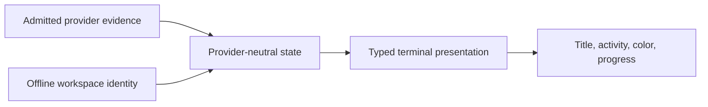

TabBeacon [v0.9.0](https://github.com/JerrySkywalker/tabbeacon/releases/tag/v0.9.0) was released on 2026-10-17, including [crates.io 0.9.0](https://crates.io/crates/tabbeacon/0.9.0) and the official Windows x64 ZIP. Owner accepted the limited post-release M3 closeout on 2026-10-18 with disclosed P6 machine-evidence gaps and no further retest. Train D remains 2 PASS / 18 SKIP; this does not certify all human, optical, terminal, Provider or OS-stall guarantees. [Bounded support](docs/v0.9.0-support-contract.md) and the prepublication [Owner packet](docs/v0.9.0-owner-review.md) retain their historical evidence scope.

<p align="center">
  
</p>

<p align="center"><strong>Live identity and status for Codex—and more—across Windows Terminal tabs, without changing how you launch them.</strong></p>

<p align="center">English | <a href="https://github.com/JerrySkywalker/tabbeacon/blob/main/README.zh-CN.md">简体中文</a></p>

<!-- tabbeacon:hero-badges:start -->
<p align="center">
  <a href="https://www.rust-lang.org/"></a>
  <a href="https://github.com/JerrySkywalker/tabbeacon/actions/workflows/ci.yml"></a>
</p>
<!-- tabbeacon:hero-badges:end -->

<p align="center"><a href="https://github.com/JerrySkywalker/tabbeacon/releases">Releases</a> · <a href="https://crates.io/crates/tabbeacon">crates.io</a> · <a href="https://github.com/JerrySkywalker/tabbeacon/blob/main/docs/README.md">Documentation</a> · <a href="https://github.com/JerrySkywalker/tabbeacon/blob/main/LICENSE">MIT License</a></p>

English/Chinese product terms: [TabBeacon terminology](docs/terminology.md). The normal Cargo package includes [简体中文 README](README.zh-CN.md); the absolute language link above also works on crates.io.

<!-- tabbeacon:critical-invariants install=cargo-install-tabbeacon setup=tabbeacon-setup codex=codex agy=agy providers=codex-agy claude=deferred opencode=deferred trust=manual fail-open=true privacy=content-minimal -->

<p align="center">
  <a href="https://github.com/JerrySkywalker/tabbeacon/blob/9215500cb3b0a9ef183c9c096a4bdde1b749da5b/docs/assets/demo/tabbeacon-demo.gif"></a>
</p>

<p align="center"><sub>Real Windows Terminal rendering from TabBeacon's deterministic presentation fixture; no live Codex or Agy model conversation.</sub></p>

## Coding Agent Scope

| Coding Agent | Status | Daily command | Compatibility policy |
| --- | --- | --- | --- |
| Codex CLI | Production | `codex` | Capability-based; a version string is diagnostic only. |
| Agy CLI | Bounded title support | `agy` | Exact 1.1.19/1.2.7 contracts; 1.2.7 real Working/noninterference proved, Ready and native switching not L4-qualified. |
| Cursor Agent | Production | `agent` | Owned project Hooks; strict color-only or preserve-native, with Cursor's native title. |

### Deferred integrations

- Claude Code — Deferred
- OpenCode — Deferred

They are not partially supported and are not enabled by this release train.

## Why TabBeacon?

Coding-agent tabs are easy to lose in a busy Windows Terminal. TabBeacon gives
each supported session a stable workspace identity and a compact, evidence-driven
status signal while preserving the commands you already use. Daily launch stays
literally `codex` or `agy`; TabBeacon is not a wrapper, PTY host, terminal
replacement, or background daemon.

## What It Looks Like

The production visual backend is title-first and intentionally compact:

```text
○ OWH     idle identity
⠋ OWH     working
✓ OWH     result ready
! OWH     attention
? OWH     question
```


> [!NOTE]
> Real Windows Terminal rendering using TabBeacon's deterministic presentation
> fixture. It is not a live Codex or Agy model conversation.

## Features

- Stable, offline-first workspace aliases with Git identity as a specialization.
- Typed title, activity, tab-color, and Windows Terminal-progress presentation.
- Evidence-driven status with fail-open behavior when an integration is absent
  or cannot prove a claim.
- Guided setup, presets, a keyboard-only Control Center, and portable
  preferences that stay user-global rather than repository-local.
- Read-only diagnostics for title, workspace, compatibility, hooks, and
  session projections without persisting prompt, assistant, or tool content.
- Ownership-safe configuration changes that preserve unrelated provider settings.

## Quick Start

The current official release is [v0.9.0](https://github.com/JerrySkywalker/tabbeacon/releases/tag/v0.9.0); v0.8.1 is the previous official version and v0.8.2 was never released. v0.9.0 uses public crates.io `terminal-ui-contract =0.2.0`, `terminal-ui-runtime =0.1.0`, and `terminal-ui-ratatui =0.1.0`. That shared delivery is complete within its adopted scope; a future cliclack-style CLI extension is separate work.

The normal Cargo user path is:

```powershell
cargo install tabbeacon
tabbeacon setup
codex
```

Review proposed configuration changes and native Hook trust manually. An unpinned install may resolve a newer version; use the exact released version when reproducibility is needed:

```powershell
cargo install tabbeacon --version 0.9.0 --locked
```

For an admitted Agy profile, `tabbeacon setup agy` configures its user-global title callback and daily launch remains `agy`. `tabbeacon setup --quick` visits only missing, stale or action-required setup work; review proposed changes before applying them.

## Upgrade and Rollback

The [v0.8.1 → v0.9.0 guide](docs/v0.9.0-upgrade.md) preserves the prepublication procedure and its historical status wording. The actual [v0.9.0 Release](https://github.com/JerrySkywalker/tabbeacon/releases/tag/v0.9.0) is now public. Cargo installation can use the pinned command above; Windows ZIP users should verify the downloaded ZIP against `SHA256SUMS.txt` and `RELEASE-PROVENANCE.json` from that Release before replacing their owned executable. There is no v0.8.2 installation step. Configuration migration, Hook reconciliation and native manual trust remain distinct operations requiring ownership review.

Binary replacement alone does not roll configuration back. Preserve exact owned before-images, unrelated settings and failed receipts; stop on ambiguous ownership or drift. Never copy old trusted hashes to new Hook definitions. Strong CAS against arbitrary external writers and all-or-nothing cross-file crash commits are explicitly unsupported, not failed requirements reintroduced into this version.

The limited post-release M3 acceptance includes an actual official-ZIP 0.9.0 → 0.8.1 → 0.9.0 binary/version/entry roundtrip with configuration preservation, ending on the official 0.9.0 EXE. It does not prove full v0.8.1 Provider/Hook production-functional rollback. P6 Provider/Shell outcomes rely on Owner attestation; new machine attempt/exit/edit receipts, the verbatim response and the specific status transition were not retained.

Train D's 18 SKIP, the historical 700 ms failure with unresolved cause and the older 24-byte reproducibility FAIL remain visible. Optical P95/100 ms, DEC private modes and strict arbitrary OS-stall exit remain UNPROVEN. Independent native review remains BLOCKED; the public release used the separately Owner-accepted bounded A+B alternative. A build or software draw is not physical/optical evidence. Repository documentation updates do not alter the already-published crate, tag or ZIP, whose embedded documents retain their original wording.

Historical context: the v0.8.0 release candidate introduced independent CLI presentation and Cursor color-only integration; its [release notes](docs/v0.8.0-release-notes.md) remain historical scope records, not current release status.

## Compatibility

TabBeacon targets Windows Terminal on Windows. Codex support is derived from
locally observed required capabilities, not from a version ordering rule. Agy
support is intentionally narrower: only exact 1.1.19 and 1.2.7 title profiles
are admitted; 1.2.13 is not. Unavailable or unproven evidence fails open instead of
being guessed into a compatible state.

## How It Works



Provider identity, runtime state, and workspace identity are separate slots.
Presentation makes their relationship visible; it never grants trust,
compatibility, configuration ownership, or process control.

## Safety & Privacy

TabBeacon is fail-open for coding agents and fail-closed for configuration
ownership. Hook trust stays manual. Normal presentation does not ingest or
persist prompt content, assistant content, or tool content. Read-only status
surfaces expose bounded operational facts rather than credentials, raw session
identifiers, or environment dumps.

Native Windows Terminal tab icons are **NO_GO** under the accepted current-host
feasibility evidence. Stock Windows Terminal has no supported public tab-icon
bridge, and the only remaining instrumentation route could not be isolated
safely. `TitleMarkBackend` remains the production visual path.

## Configuration

Use the guided flow for cohesive setup, or inspect and change closed typed
preferences directly:

```powershell
tabbeacon config show
tabbeacon config wizard
tabbeacon config set spinner braille
tabbeacon config set theme muted-dark
tabbeacon config preset balanced
tabbeacon ui
```

Preferences are distinct from provider integration state, Hook trust, and
runtime/session evidence. See the [Codex Hooks guide](https://github.com/JerrySkywalker/tabbeacon/blob/main/docs/codex-hooks.md)
and [Agy setup guide](https://github.com/JerrySkywalker/tabbeacon/blob/main/docs/agy-setup.md)
for current ownership boundaries.

## Documentation

- [Documentation portal](https://github.com/JerrySkywalker/tabbeacon/blob/main/docs/README.md)
- [Technical overview](https://github.com/JerrySkywalker/tabbeacon/blob/main/docs/architecture.md)
- [Architecture](https://github.com/JerrySkywalker/tabbeacon/blob/main/docs/architecture.md)
- [Codex Hooks](https://github.com/JerrySkywalker/tabbeacon/blob/main/docs/codex-hooks.md)
- [Agy setup](https://github.com/JerrySkywalker/tabbeacon/blob/main/docs/agy-setup.md)
- [Codex compatibility](https://github.com/JerrySkywalker/tabbeacon/blob/main/docs/CODEX_COMPATIBILITY_V3.md)
- [Terminal visual backends](https://github.com/JerrySkywalker/tabbeacon/blob/main/docs/TERMINAL_VISUAL_BACKENDS.md)
- [Native tab-icon disposition](https://github.com/JerrySkywalker/tabbeacon/blob/main/docs/research/WT_NATIVE_ICON_DISPOSITION.md)

## Contributing

The v0.9.0 development cycle has reached Owner-accepted limited M3 closeout. A next-version change starts from current `main` with its own scope under `AGENTS.md`; historical Fast Lane Goals are evidence records, not an active instruction to replay R0–R3 or P5–P7. Administrative tracker closure is recorded separately when authorized. No next-version feature or cliclack extension is started by this documentation change.

Contributions are welcome. Start with [CONTRIBUTING.md](https://github.com/JerrySkywalker/tabbeacon/blob/main/CONTRIBUTING.md); use a
focused branch and let exact-head CI validate the candidate. High-risk changes
to provider configuration, process targeting, or terminal instrumentation have
additional governance and safety boundaries.

## License

TabBeacon is licensed under the [MIT License](https://github.com/JerrySkywalker/tabbeacon/blob/main/LICENSE).
