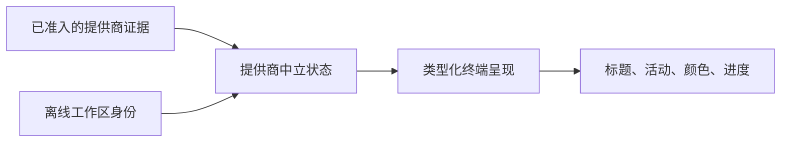

未发布的 v0.9.0 发行材料候选：[Owner Review](docs/v0.9.0-owner-review.md)、[有界支持合同（简体中文 / English）](docs/v0.9.0-support-contract.md)、[v0.8.1 → v0.9.0 升级回滚](docs/v0.9.0-upgrade.md)。Owner 已接受 `6fb27e3707aa859864873b2feadc81d383ca9749` 的有界工程基线；本材料候选仍待 Owner 审查和独立发布授权。真人验收保持 PARTIAL（2 PASS / 18 SKIP）；光学 P95、实际终端恢复、DEC 私有模式、当前真实 Provider 及严格 OS stall 退出仍 UNPROVEN。

<p align="center">
  
</p>

<p align="center"><strong>为 Windows Terminal 中的 Codex（以及更多编码智能体）标签页提供实时身份与状态，同时不改变你的启动方式。</strong></p>

<p align="center">简体中文 | <a href="https://github.com/JerrySkywalker/tabbeacon/blob/main/README.md">English</a></p>

<!-- tabbeacon:hero-badges:start -->
<p align="center">
  <a href="https://www.rust-lang.org/"></a>
  <a href="https://github.com/JerrySkywalker/tabbeacon/actions/workflows/ci.yml"></a>
</p>
<!-- tabbeacon:hero-badges:end -->

<p align="center"><a href="https://github.com/JerrySkywalker/tabbeacon/releases">发布版本</a> · <a href="https://crates.io/crates/tabbeacon">crates.io</a> · <a href="https://github.com/JerrySkywalker/tabbeacon/blob/main/docs/README.md">文档</a> · <a href="https://github.com/JerrySkywalker/tabbeacon/blob/main/LICENSE">MIT 许可证</a></p>

中英产品用语：[TabBeacon 术语表](docs/terminology.md)。正常 Cargo 包包含本中文文件及 [English README](README.md)；上方绝对语言链接同时供 crates.io 使用。

<!-- tabbeacon:critical-invariants install=cargo-install-tabbeacon setup=tabbeacon-setup codex=codex agy=agy providers=codex-agy claude=deferred opencode=deferred trust=manual fail-open=true privacy=content-minimal -->

<p align="center">
  <a href="https://github.com/JerrySkywalker/tabbeacon/blob/9215500cb3b0a9ef183c9c096a4bdde1b749da5b/docs/assets/demo/tabbeacon-demo.gif"></a>
</p>

<p align="center"><sub>由 TabBeacon 确定性展示夹具驱动的真实 Windows Terminal 渲染；不包含实时 Codex 或 Agy 模型对话。</sub></p>

## 编码智能体范围

| 编码智能体 | 状态 | 日常命令 | 兼容性策略 |
| --- | --- | --- | --- |
| Codex CLI | 生产支持 | `codex` | 基于能力；版本字符串仅用于诊断。 |
| Agy CLI | 有界标题支持 | `agy` | 精确 1.1.19/1.2.7 合同；1.2.7 真人 Working/互不干扰已证明，Ready/原生切换未获真人资格；不包括 1.2.13。 |
| Cursor Agent | 生产支持 | `agent` | 受管项目 Hook；严格仅颜色或保留原生，标题由 Cursor 控制。 |

### 延后集成

- Claude Code — Deferred
- OpenCode — Deferred

它们不是部分支持，也不会在此发布列车中启用。

## 为什么选择 TabBeacon？

在繁忙的 Windows Terminal 中，编码智能体标签页很容易混在一起。TabBeacon
为已支持的会话提供稳定的工作区身份和紧凑、由证据驱动的状态提示，同时保留你
已经在使用的命令。日常启动仍然是字面量 `codex` 或 `agy`；TabBeacon 不是包装器、
PTY 主机、终端替代品或后台守护进程。

## 它是什么样子？

生产视觉后端以标题为先，并且刻意保持紧凑：

```text
○ OWH     空闲身份
⠋ OWH     正在工作
✓ OWH     结果就绪
! OWH     需要注意
? OWH     问题
```


> [!NOTE]
> 由 TabBeacon 确定性展示夹具驱动的真实 Windows Terminal 渲染效果；这不是实时
> Codex 或 Agy 模型对话。

## 功能

- 离线优先的稳定工作区别名，并将 Git 身份作为一种专门化形式。
- 类型化的标题、活动状态、标签颜色和 Windows Terminal 进度呈现。
- 证据驱动的状态；当集成缺失或无法证明某项声明时保持 fail-open。
- 引导式设置、预设、键盘操作的 Control Center，以及保留在用户全局范围内而非
  仓库本地的可移植偏好设置。
- 标题、工作区、兼容性、Hook 和会话投影的只读诊断；不会持久化 prompt、助手或
  工具内容。
- 保留无关提供商设置的、所有权安全的配置变更。

## 快速开始

截至 2026-10-15 已核验的最新正式版本为 [v0.8.1](https://github.com/JerrySkywalker/tabbeacon/releases/tag/v0.8.1)，v0.8.2 从未正式发布。Draft PR #123 准备 v0.9.0，精确使用公开 crates.io 的 `terminal-ui-contract =0.2.0`、`terminal-ui-runtime =0.1.0`、`terminal-ui-ratatui =0.1.0`。共享 API 已由 Owner 冻结于 `eb16cd91f924c145180b5befcf9f2cacc7a46d84`；包源码另为 `206325e2367cda90f8cbe5d418dc7761da5f81bb`。共享依赖公开不等于 TabBeacon v0.9.0 已发布或已安装。

当前公开 CLI 的普通用户路径仍为：

```powershell
cargo install tabbeacon
tabbeacon setup
codex
```

这是用户操作说明，本材料验证列车没有执行这些命令。设置要求时仍须手动审查 Hook 信任。未来不固定版本的安装可能取得更新版本；精确发布验证应固定已接受版本：

```powershell
cargo install tabbeacon --version 0.8.1 --locked
```

对于已准入的 Agy 配置，`tabbeacon setup agy` 配置用户全局标题回调，日常启动仍为 `agy`。`tabbeacon setup --quick` 仅处理缺失、过期或需要操作的设置工作；应用前审查变更。

## 升级与回滚

使用正式的 [v0.8.1 → v0.9.0 升级和回滚指南](docs/v0.9.0-upgrade.md)。指南分别说明源码/包/Windows 哈希、归属明确的预检、精确获准安装、具名 Hook 协调、原生手工信任和实际恢复检查。不经过 v0.8.2。v0.9.0 安装命令仅供未来使用，须先接受精确发布对象、验证真实公开状态并另行取得授权。

替换 EXE 不等于配置回滚。保留精确自有 before-image、无关设置和失败回执；归属或漂移有歧义即停止。不得把旧信任哈希复制到新 Hook。对任意外部写者的强 CAS 和跨文件崩溃时全有或全无明确不支持，不重新设为本版门禁。

本候选的精确 Cargo 包、两次 Release 原始构建哈希、ZIP 和 CI 记录在 Owner 证据回执。软件 draw/build 成功不是光学延迟或真人终端验收；材料验证不证明真实 Provider、正式安装、Hook 信任或实际生产回滚。

历史背景：v0.8.0 发布候选引入按 CLI 独立呈现和 Cursor 仅颜色接入；其[发布说明](docs/v0.8.0-release-notes.md)保留历史范围，不代表当前发布状态。

## 兼容性

TabBeacon 面向 Windows 上的 Windows Terminal。Codex 支持由本地观察到的必需能力
确定，而不是由版本排序规则确定。Agy 支持刻意更窄：只有精确准入的 1.1.19 和 1.2.7 标题配置
被准入。1.2.7 的真人 Working 与互不干扰已有证明；Ready 可见转换和原生模式切换
未获得真人 L4 资格，不属于本版公开承诺。不可用或未证明的证据会 fail-open，而不会被猜测为兼容状态。

## 工作方式



提供商身份、运行时状态和工作区身份是三个独立槽位。呈现使它们之间的关系可见；
它从不授予信任、兼容性、配置所有权或进程控制权。

## 安全与隐私

TabBeacon 对编码智能体 fail-open，对配置所有权 fail-closed。Hook 信任保持手动。
正常呈现不会采集或持久化 prompt 内容、助手内容或工具内容。只读状态表面只公开
受限的运行事实，而不会公开凭据、原始会话标识符或环境转储。

在已接受的当前主机可行性证据下，Windows Terminal 原生标签图标为 **NO_GO**。
库存 Windows Terminal 没有受支持的公开标签图标桥接；仅剩的仪器化路径无法安全
隔离。`TitleMarkBackend` 仍是生产视觉路径。

## 配置

建议使用引导流程进行完整设置；也可以直接查看和修改封闭的类型化偏好：

```powershell
tabbeacon config show
tabbeacon config wizard
tabbeacon config set spinner braille
tabbeacon config set theme muted-dark
tabbeacon config preset balanced
tabbeacon ui
```

偏好设置与提供商集成状态、Hook 信任和运行时/会话证据彼此独立。当前所有权边界请
参阅 [Codex Hooks 指南](https://github.com/JerrySkywalker/tabbeacon/blob/main/docs/codex-hooks.md)
和 [Agy 设置指南](https://github.com/JerrySkywalker/tabbeacon/blob/main/docs/agy-setup.md)。

## 文档

- [文档入口](https://github.com/JerrySkywalker/tabbeacon/blob/main/docs/README.md)
- [技术概览](https://github.com/JerrySkywalker/tabbeacon/blob/main/docs/architecture.md)
- [架构](https://github.com/JerrySkywalker/tabbeacon/blob/main/docs/architecture.md)
- [Codex Hooks](https://github.com/JerrySkywalker/tabbeacon/blob/main/docs/codex-hooks.md)
- [Agy 设置](https://github.com/JerrySkywalker/tabbeacon/blob/main/docs/agy-setup.md)
- [Codex 兼容性](https://github.com/JerrySkywalker/tabbeacon/blob/main/docs/CODEX_COMPATIBILITY_V3.md)
- [终端视觉后端](https://github.com/JerrySkywalker/tabbeacon/blob/main/docs/TERMINAL_VISUAL_BACKENDS.md)
- [原生标签图标结论](https://github.com/JerrySkywalker/tabbeacon/blob/main/docs/research/WT_NATIVE_ICON_DISPOSITION.md)

## 贡献

欢迎贡献。请从 [CONTRIBUTING.md](https://github.com/JerrySkywalker/tabbeacon/blob/main/CONTRIBUTING.md) 开始，使用聚焦分支，并让精确
HEAD CI 验证候选提交。提供商配置、进程定位或终端仪器化等高风险变更还有额外的
治理和安全边界。

## 许可证

TabBeacon 采用 [MIT 许可证](https://github.com/JerrySkywalker/tabbeacon/blob/main/LICENSE)。
